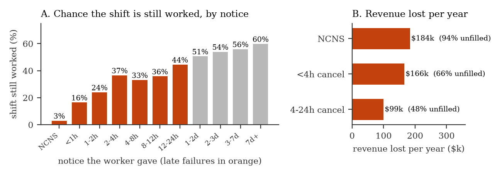
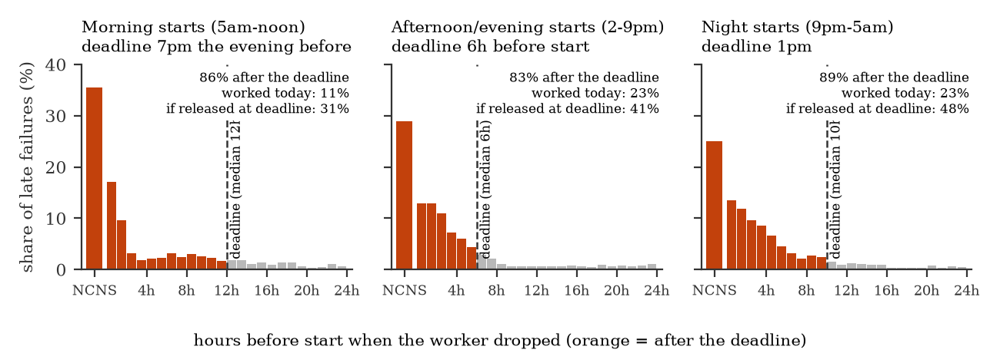

# Clipboard Marketplace Reliability Case Study

XXX ONE-LINER

*Grace Yang*

> **Summary**
>
> **The problem at hand.** 13.3% of booked Cleveland shifts are hit by a no-call-no-show (NCNS) or a cancellation less than 24 hours before start, and 9 in 100 go unworked. That costs about **$449k of revenue a year in Cleveland** (about $5.1M across markets).
>
> **The data says.** The damage depends on *when we hear* about a drop, not on how hard we punish it. A shift is still worked 3% of the time after an NCNS, but 59% of the time after a cancellation 3+ days out. Penalties show no measurable deterrent effect. And risk is concentrated: half of all bookings hold 77% of late failures.
>
> **My proposal.** For those bookings only, ask for a one-tap "yes" by a deadline (7pm the evening before, for a morning shift). A "no", or no reply, releases the shift at once to the facility's regular workers. Proven professionals are never asked.
>
> **Expected impact.** Base case, per year: 25% fewer NCNS, 27% fewer call-offs and 658 more Cleveland shifts worked. That is $44k of revenue in Cleveland and **about $0.5M across markets**, for about $9k a year to run. Messaging pays for itself if 2.3% of covered drops come in early.
>
> **Investment needed.** About six engineer-weeks to build, then an 8-week A/B test in Cleveland plus three similar markets. Go/no-go in week 14.

## 1. Introduction

**Background.** Clipboard matches healthcare professionals to open shifts at healthcare facilities, and both sides are our customers. Facilities need the shift worked; professionals come to us for the flexibility to choose when and where they work. Today we rely on in-app reminders and the mid-2021 attendance policy. The policy gives strikes for NCNS, call-offs (cancellations less than 4 hours before start) and standard cancellations (4–72 hours), leading to suspension and then deactivation. It moved the needle, but only a little.

**The current issue.** I call an NCNS or a cancellation less than 24 hours before start a **late failure**, and count a shift as **worked** if it has a verified timesheet.

**Table 1. Late failures in Cleveland, Oct 2021–Jan 2022**

| Failure type | Shifts hit (4 months) | Still worked | Left unfilled | Revenue lost per year |
|---|---:|---:|---:|---:|
| No-call-no-show (NCNS) | 964 | 3% | 94% | $184k |
| Call-off (cancelled <4h before start) | 1,263 | 26% | 66% | $166k |
| Cancelled 4–24h before start | 962 | 37% | 48% | $99k |
| *For reference: cancelled >72h before start* | *2,365* | *59%* | *6%* | — |

Late failures hit 3,189 shifts in four months, and 2,196 of them were never worked: 9.2 of every 100 booked shifts. What separates the rows is **notice**. In the final four hours before a shift, each extra hour of notice raises the chance the shift is re-booked by 5–9 points (Appendix B).

> **Problem statement.** When a professional can't make a booked shift, we usually find out too late to replace them, so 9.2 of every 100 booked Cleveland shifts go unworked. **The outcome I am solving for:** when a facility books a Clipboard professional, the shift gets worked, without taking flexibility away from the professionals who have earned it.

## 2. The solution, grounded in data

### 2.1 What the data shows

I used the Cleveland shift log (38,152 CNA, LVN and RN shifts after cleaning; Table A1) and the all-market booking and cancellation logs (122,362 bookings, Oct–Nov 2021; Appendix A). Every warning rule was chosen on Nov 1–15 and scored on Nov 16–30, so no rule is graded on the data that built it.

**1. Penalties are not changing behavior.** A call-off at 3h50m earns a strike and a cancellation at 4h10m does not. Yet both groups fail late at the same rate over the next 30 days (−1 point; 95% CI −8 to +6). Workers do not time their cancellations to dodge strikes, and 73% book again within a week of their second call-off (Appendix C). → *More punishment is unlikely to help. Changing **when** we hear about a drop can.*

**2. Notice decides whether the shift is saved.** For morning shifts, 68% of late drops happen overnight (10pm–7am), and only 14% of those shifts get refilled. Refills happen fast or not at all: 74% of re-bookings after a call-off come within the hour. Facilities with a deep bench refill twice as often (35% vs 17%), and below-norm reposts lose 13 points. → *Create notice while workers are awake. Release instantly, to the facility's regulars first, at no less than the usual rate.*

**3. Risk is concentrated in bookings we can name in advance.** Of 21 warning signs tested, the best simple rule flags workers who are *not yet proven*: fewer than 5 past bookings, or a past late-failure rate of 10% or more. In the test period it flags 42% of bookings and catches 71% of late failures. Flagged bookings fail late 19.6% of the time, against 5.7% for everyone else. A statistical model using all 21 signs did no better. → *Target the check, and leave proven professionals alone.*

**4. Two situations raise risk for anyone.** In the 48 hours after a late drop, a worker's other shifts fail late 27% of the time, against 10% otherwise. A first shift at a facility fails 1.8 times as often as a repeat visit, even for experienced workers. → *Both become triggers for the check.*

**5. Most late failures are still chance.** Only about 18% of the variation in late failures is predictable, 86% of that from the worker and 14% from the facility. → *Prediction alone cannot prevent most drops. The design has to bring them to light earlier.*

### 2.2 What we can assume from this

**Table 2. Assumptions**

| Assumption | Why it is reasonable | If it is wrong |
|---|---|---|
| Late drops are mostly situational, so deterrence has reached its limit | Finding 1; the top reasons (sickness, family, transport) are not choices a strike changes | Penalties could do more, but deactivation is costly (Section 4) |
| **Some workers who will drop would say so earlier if asked directly and "no" were painless** | The central bet, with no direct data. Today an NCNS gives zero notice | The A/B test measures it. Table 6 values every level, and break-even is 2.3% |
| A released shift refills as often as past shifts dropped with that much notice | Same facilities, roles and times of day | Revenue falls in proportion (Section 3.2) |
| Cleveland's dynamics hold in other markets | Given by the case; the rule catches 68% of late failures in Cleveland, 71% elsewhere | A shadow run checks each market first |
| 5% of checked workers who meant to come never confirm | Workers already act on app reminders | About 785 wrongful releases a year (2% of checks), limited by soft release |

### 2.3 The solution: Confirm-or-Release

> **Ask the bookings most likely to fail for an explicit "yes" by a deadline. Treat a "no", or silence, as an early release while the shift can still be filled.**

**Who is asked.** A booking is checked if **(A)** the worker is not yet proven, **(B)** they dropped another shift late in the last 48 hours, or **(C)** it is their first shift at this facility. Together these cover **49% of bookings and 77% of late failures**, including 74% of NCNS and 82% of call-offs (Appendix D). Proven professionals at facilities they know are never asked. That is the reward for reliability.

**When.** Deadlines are set by start time, so workers and the bench are awake (Appendix E).

**Table 3. Confirmation deadlines (late failures that happen after the deadline)**

| Shift starts | Confirm by | Share of late failures after the deadline | Worked today | Worked if released at the deadline |
|---|---|---:|---:|---:|
| Morning (5am–noon) | 7pm the evening before | 86% | 11% | 31% |
| Afternoon/evening (2–9pm) | 6 hours before start | 83% | 23% | 41% |
| Night (9pm–5am) | 1pm the day the night begins | 89% | 23% | 48% |
| Midday (noon–2pm) | 9pm the evening before | too rare to measure | | |

**How workers are asked.**

- **At booking**, an in-app note and a text explain the check. **Before the deadline**, an in-app prompt and a text ask: *"Reply Y to confirm, N if you can't make it."* Up to three pushes follow, then one automated call an hour before the deadline (two after a past NCNS). Messages stop the moment the worker confirms, and none are sent 10pm–7am.
- **No strike for "no".** Replying N carries no penalty, so the honest answer is the easy one. Confirming and then dropping late does cost proven status.

**What happens on a "no", or no reply.** The shift is reposted at once, at no less than the facility's usual rate. It goes first to workers who worked at that facility in the last 30 days, then to everyone qualified, and the facility is told. On no reply the release is *soft*: the worker keeps the shift unless someone else claims it first.

### 2.4 Tuned by role and time

Roles differ in how they fail and refill (Table A1, Appendix G), so the settings differ.

**Table 4. Confirm-or-Release, by role**

| Role | Late failures (lost revenue) | What stands out | How the design is set |
|---|---:|---|---|
| **CNA** | 80% (70%) | Volume: mornings alone are 28% of all late failures | Core design, mornings first: the 7pm deadline lifts refill from 12% to about 36% |
| **LVN** | 17% (26%) | Scarcity: thin bench; only 14% refilled after a late failure | Release wider (all LVNs, plus RNs who take LVN shifts); arrival instructions on first visits |
| **RN** | 2% (4%) | Already reliable: 5.7% late-failure rate, vs 14.2% for CNAs | Standard rule; RNs cover LVN overflow |

**Time matters for every role.** At equal notice, a dropped morning shift has half the odds of being refilled (p < 0.001), so morning deadlines fall the evening before.

## 3. Expected impact

### 3.1 Scenarios

I applied each window's deadline to the 3,189 Cleveland shifts with a late failure. Every NCNS and call-off happens after its deadline, as do 53% of 4–24h cancellations. A covered failure that surfaces at the deadline instead is assumed to be worked as often as past shifts dropped with that much notice in the same window. Two inputs have no history, so I vary both: the share of covered drops that **surface** at the deadline, and the share **prevented** outright (Appendix F).

**Table 5. Impact scenarios (per year)**

| | Conservative | **Base** | Optimistic |
|---|---:|---:|---:|
| *Assumed:* covered drops that surface at the deadline / prevented outright | 15% / 0% | **30% / 5%** | 50% / 10% |
| NCNS turned into advance notice or prevented | 11% | **25%** | 41% |
| Call-offs avoided | 12% | **27%** | 45% |
| Extra Cleveland shifts worked (unfilled per 100 booked; 9.2 today) | 195 (8.9) | **658 (8.3)** | 1,161 (7.6) |
| Cleveland revenue (facility billings) | $13k ($59k) | **$44k ($201k)** | $78k ($355k) |
| Cleveland running cost (messages + rate floor, upper bound) | $6k | **$9k** | $13k |
| Revenue across all markets (Cleveland = 8.8% of bookings) | $0.15M | **$0.50M** | $0.89M |

### 3.2 Sensitivity: what each level of improvement is worth

Table 6 crosses the two untested inputs from Section 3.1. Bold cells are Table 5's three scenarios.

**Table 6. Cleveland revenue regained per year, by the two untested assumptions**

<table class="grid"><colgroup><col style="width:15%"><col style="width:17%"><col style="width:13%"><col style="width:11%"><col style="width:11%"><col style="width:11%"><col style="width:11%"><col style="width:11%"></colgroup>
<thead>
<tr><th colspan="3" class="grp">Early notice alone</th><th colspan="5" class="grp sep">Covered drops prevented outright</th></tr>
<tr class="sub"><th>Drops surfacing early</th><th>NCNS + call-offs turned into notice</th><th>Extra shifts worked</th><th class="sep">0%</th><th>5%</th><th>10%</th><th>15%</th><th>20%</th></tr>
</thead>
<tbody>
<tr><td>5%</td><td>4%</td><td>65</td><td class="heat sep" style="background:#F1F8F3">$4k</td><td class="heat" style="background:#DBEEE1">$24k</td><td class="heat" style="background:#C5E3CF">$43k</td><td class="heat" style="background:#AFD9BE">$62k</td><td class="heat" style="background:#9ACEAC">$81k</td></tr>
<tr><td>10%</td><td>8%</td><td>130</td><td class="heat sep" style="background:#ECF6EF">$9k</td><td class="heat" style="background:#D6EBDD">$28k</td><td class="heat" style="background:#C1E1CC">$47k</td><td class="heat" style="background:#ABD7BA">$66k</td><td class="heat" style="background:#96CCA9">$85k</td></tr>
<tr><td>15%</td><td>12%</td><td>195</td><td class="heat sep" style="background:#E7F3EB"><strong>$13k</strong></td><td class="heat" style="background:#D2E9DA">$32k</td><td class="heat" style="background:#BCDFC8">$51k</td><td class="heat" style="background:#A7D5B7">$70k</td><td class="heat" style="background:#92CAA5">$88k</td></tr>
<tr><td>20%</td><td>16%</td><td>260</td><td class="heat sep" style="background:#E2F1E7">$17k</td><td class="heat" style="background:#CDE7D6">$36k</td><td class="heat" style="background:#B8DDC5">$55k</td><td class="heat" style="background:#A3D3B3">$73k</td><td class="heat" style="background:#8EC8A2">$92k</td></tr>
<tr><td>30%</td><td>24%</td><td>389</td><td class="heat sep" style="background:#D8ECDF">$26k</td><td class="heat" style="background:#C4E2CE"><strong>$44k</strong></td><td class="heat" style="background:#AFD8BD">$62k</td><td class="heat" style="background:#9ACEAD">$81k</td><td class="heat" style="background:#86C59C">$99k</td></tr>
<tr><td>50%</td><td>39%</td><td>649</td><td class="heat sep" style="background:#C5E3CF">$44k</td><td class="heat" style="background:#B1D9BF">$61k</td><td class="heat" style="background:#9DD0AF"><strong>$78k</strong></td><td class="heat" style="background:#8AC69F">$95k</td><td class="heat" style="background:#76BD8F">$113k</td></tr>
</tbody>
</table>

**Break-even is low.** Messages pay for themselves at 2.3% surfacing and the full running cost at about 3%, so every cell is net positive. Across all markets, multiply by about 11. If released shifts gain only half as much as history suggests, the 0% column halves; prevention gains do not depend on refill.

### 3.3 Proving it: the A/B test

**Design.** Checked bookings are randomized 50/50 between Confirm-or-Release and today's reminders. The test runs for 8 weeks in Cleveland plus three markets of similar size, giving about 8,750 checked bookings per arm. That is enough to reliably detect an 11% change in unfilled shifts and a 12% change in no-notice failures (Appendix F). I randomize by *booking*, not by worker: one worker's shifts are correlated, so randomizing by worker would make the test 2.2–2.7 times noisier. Results are also read by role and start window to tune Table 4's settings, though the test is not powered for each segment alone.

**Table 7. Metrics (checked bookings, test arm vs control)**

| Role | Metric | Baseline | Base-case target |
|---|---|---:|---:|
| Primary | Shifts left unfilled after a late failure, per 100 checked bookings | 12.7 | −13% |
| Mechanism | No-notice failures (NCNS + call-offs), per 100 checked bookings | 11.4 | −34% |
| Secondary | Confirmation rate; drops after confirming; time to re-book | — | Track |
| Guardrails | Wrongful releases; checked workers' bookings over the next 30 days | — | ≤2% of checks; not down >5% |
| Guardrails | New workers' second-booking rate; overall fill rate (63.4% today); opt-outs | — | Not down |

**Raw late-cancellation counts will rise, and that is success.** An NCNS that becomes a release at 7pm the evening before still counts as a late cancellation, so the test is judged on shifts left unworked.

**Decision rule in week 14.**

- **Scale** if no-notice failures fall by at least 15% (statistically significant), unfilled shifts fall by at least 4% (the conservative case), and no guardrail is breached.
- **Iterate** if no-notice failures fall but unfilled shifts do not. Refilling is then the bottleneck, so test a pay premium on released shifts next.
- **Stop** if no-notice failures fall by less than 5%, or if a guardrail is breached two weeks running.

### 3.4 Execution: the plan and the levers

**Table 8. Plan (week 1 = approval)**

| Weeks | Job to be done | Owner | Done when |
|---|---|---|---|
| 1–3 | Build the trigger and deadline service; the confirmation flow (text, push, call, consent, quiet hours); the release flow (soft release, rate floor, role-specific audience) | Data eng.; Professional app + Product; Marketplace eng. | Matches Appendix D on last month's data; end-to-end tests pass; test shift reposted in <1 minute |
| 2–3 | Write copy, FAQs and support scripts | Professional Ops; Facility Success | Copy approved |
| 4–5 | Shadow run (compute checks, send nothing); randomization; dashboard | Data | Within 5 points of plan; dashboard live |
| 6–13 | Run the test, with a weekly guardrail review | Owner (me) | — |
| 14 | Read out the results; go/no-go | Owner, then executive team | Decision recorded |
| 15+ | Roll out market by market; test premiums on released shifts | Owner | — |

**Levers to tune during the test**, with no new engineering:

- **Who is checked:** widen if unchecked bookings still drive no-notice failures; narrow if checked workers book less.
- **Deadline:** earlier if drops still arrive after it; later if workers who would have come say "no".
- **Reminders** (3 pushes + 1 call): add if workers show up unconfirmed; cut if opt-outs rise.
- **Release on no reply** (soft): make firm if soft-released workers rarely turn up and wrongful releases stay well under 2%.

## 4. Why this, and not something else

**Table 9. Alternatives considered**

| Alternative | Why not first |
|---|---|
| Stricter penalties or deactivation | No measurable deterrent at today's cut-offs. Deactivating the 56 Cleveland workers at the 2021 thresholds would remove 9.5% of hours worked to cut lost revenue by about 11%. |
| Pay premiums on dropped shifts | Weak evidence: +2 points of refill per +10% of pay (p = 0.08). A 10% premium breaks even only if refills rise from 31% to about 56%. Better tested later, on released shifts. |
| A predictive risk score, or facility-focused fixes | A model did no better than the simple rule, and workers cannot contest a score. Facilities explain only 14% of predictable risk. |
| A paid standby pool | Pays for idle capacity. Releasing to a facility's regulars uses the existing bench at no cost. |

Confirm-or-Release is the largest lever that neither removes supply nor pays for it. It reaches 77% of late failures for roughly the price of a text message.

**Counterarguments.**

**"Recovering about 10% of lost revenue is incremental."** Revenue is the smallest part of the gain. The base case turns a quarter of NCNS, the most damaging failure, into advance notice. A facility told at 7pm can call in its own staff even if we don't refill, and late failures are linked to facility churn. Neither benefit is counted in the revenue figures.

**"Professionals will feel policed, and we'll lose supply."** Half of bookings are never touched, "no" carries no strike, and workers graduate after 5 clean bookings. Guardrails watch booking volume, including among new workers, who made 33% of Dec–Jan bookings.

**"We'll release people who meant to come," or "they'll confirm and drop anyway."** Releases on no reply are soft and capped at 2% of checks. Confirming and then dropping leaves us no worse off than today, and costs proven status.

**Limitations.** The data is observational, covers four months including the holidays, and has shift outcomes and roles only for Cleveland; RN samples are small. Booking histories start in August 2021, so some long-tenured workers look new. Above all, the central bet has no precedent in our data, which is why this is a test with a decision rule set in advance.

## Appendix

### A. Data and definitions

**Roles.** Only the Cleveland shift log records which role a shift asks for. CNAs, LVNs and RNs make up 95% of postings and are the only roles analysed; the rest are removed in cleaning (below).

**Table A1. Cleveland shift log by role, Oct 2021–Jan 2022**

| Role | Shifts posted | Facilities | Workers | Median charge per hour | Cancelled by facility | Filled, of shifts not cancelled by facility | Share of billings | Kept after cleaning | Booked |
|---|---:|---:|---:|---:|---:|---:|---:|---:|---:|
| CNA | 24,662 | 61 | 670 | $32 | 31% | 73% | 64% | 24,007 | 18,140 |
| LVN | 11,277 | 60 | 240 | $47 | 39% | 45% | 27% | 11,070 | 4,672 |
| RN | 3,139 | 34 | 86 | $65 | 37% | 39% | 9% | 3,075 | 1,137 |
| NURSE | 1,907 | 28 | 0 | $0 | 43% | 0% | 0% | Removed | — |
| Caregiver | 31 | 8 | 3 | $30 | 42% | 17% | <0.1% | Removed | — |
| Medical Technician, PT, Medical Aide | 24 | 5 | 0 | $7 | 50% | 0% | 0% | Removed | — |
| **All roles** | **41,040** | **67** | **997** | **$37** | **34%** | **61%** | **100%** | **38,152** | **23,949** |

*Raw log except the last two columns. Workers are distinct professionals assigned to a shift. Charge is the hourly rate billed to the facility; at the 22% take rate, professionals earn about 78% of it (about $25, $37 and $51 an hour for CNAs, LVNs and RNs). Billings are charge × hours on worked shifts. Booked shifts (ones a professional ever booked) are the base for Table G1.*

Shifts that facilities still need go unfilled 55% of the time for LVNs and 61% for RNs, against 27% for CNAs. That scarcity is what Section 2.4 builds on.

**Cleaning.** Each rule is logged with the rows it removes.

- **Cleveland shifts, 41,040 → 38,152.** Removed:
    - 1,907 "NURSE" shifts (charge always zero, never worked; Table A1);
    - 476 shifts on 17 Jan 2022, a day whose late-failure rate was more than 5 robust standard deviations above normal;
    - 229 shifts posted after they started;
    - 123 verified shifts with no worker;
    - 97 with impossible durations;
    - 55 in rare roles (caregiver, medical technician, PT, medical aide);
    - 1 with no start time.
- **Bookings, 127,005 → 123,368; cancellations, 78,073 → 76,947.** Removed rows had no worker, were logged after the shift started, were duplicates, or belonged to removed shifts. Where one booking was logged as both a cancellation and an NCNS, I kept the first event.

Cleaning lowers Cleveland's late-failure rate from 14.8% to 13.3%. No conclusion changes on the raw data.

**Booking cohort.** 122,362 bookings for shifts starting Oct 1–Nov 30, 2021, across all markets. Worker-history features use only events logged before the moment they describe. Rules were chosen on Nov 1–15 starts and tested on Nov 16–30. Revenue is 22% of charge × hours, and "per year" means four months of Cleveland data × 3.

### B. Notice decides whether a shift is saved

*Figure B1. Cleveland shifts with a worker failure, Oct 2021–Jan 2022.*

- *Panel A: the share of shifts still worked, by the notice the worker gave.*
- *Panel B: revenue lost per year to shifts left unfilled, by failure type.*

### C. Penalties do not change behavior

I compared workers whose cancellation fell just inside a penalty cut-off with workers whose cancellation fell just outside it (regression discontinuity: local linear fit, triangular kernel, 95% CIs clustered by worker).

**Table C1. Effect of a heavier penalty on the worker's late failures in the next 30 days**

| Cut-off compared (window) | Workers | Rate without the penalty | Effect (95% CI) | p |
|---|---:|---:|---|---:|
| Call-off (<4h) vs standard cancellation (±1h) | 2,269 | 80.8% | −1.3 pts (−8.2, +5.7) | 0.72 |
| Call-off (<4h) vs standard cancellation (±2h) | 4,606 | 80.4% | −0.5 pts (−5.4, +4.5) | 0.86 |
| Standard strike (≤72h) vs no strike (±4h) | 787 | 64.5% | −11.5 pts (−25.7, +2.7) | 0.11 |
| Standard strike (≤72h) vs no strike (±8h) | 1,469 | 65.7% | −10.4 pts (−21.0, +0.2) | 0.055 |

Balance checks pass: the two sides do not differ in late failures or bookings in the 14 and 30 days *before* the cancellation.

More evidence on penalties:

- **No bunching.** Compare cancellations in the 30 minutes just after a cut-off (lighter penalty) with the 30 minutes just before. The ratio is 0.90 at 4h, 0.98 at 24h and 0.87 at 72h. Workers timing their drops to dodge penalties would push it above 1.
- **Workers keep booking.**
    - 57% of workers booked a new shift within 7 days of their first NCNS.
    - 73% did so within 7 days of their second call-off.
    - Of the 1,444 workers who reached a deactivation threshold before Jan 15, 72% were still booking more than a week later. The case notes that some offences were excused.

### D. Who gets checked

**Table D1. Bookings still on the books 24h before start, Nov 2021, all markets**

| Trigger | Checked | NCNS covered | Call-offs covered | 4–24h covered | All late covered | Late-failure rate, checked / not |
|---|---:|---:|---:|---:|---:|---:|
| A. Not yet proven (<5 past bookings, or late-failure rate ≥10%) | 41% | 67% | 76% | 68% | 70% | 19.6% / 5.7% |
| B. Dropped another shift late in the last 48h | 9% | 12% | 22% | 20% | 18% | 23.9% / 10.3% |
| C. First shift at this facility | 18% | 27% | 27% | 29% | 28% | 18.0% / 10.0% |
| **A or B or C (proposal)** | **49%** | **74%** | **82%** | **76%** | **77%** | **18.0% / 5.1%** |
| A or B or C, Cleveland only | 55% | 74% | 82% | 76% | 78% | 17.9% / 6.3% |

**Out-of-time test of rule A** (chosen on Nov 1–15, scored on Nov 16–30). It flags 42% of bookings and catches:

- 69% of NCNS;
- 75% of call-offs;
- 69% of 4–24h cancellations;
- 71% of all late failures.

As a benchmark, a logistic model on all 21 signals catches 64–72% when flagging 35% of bookings.

**Late-failure rate by group** (test period):

| Group | Late-failure rate |
|---|---:|
| No history | 22.9% |
| 1–4 past bookings, clean | 15.0% |
| 1–4 past bookings, at least one failure | 25.2% |
| 5+ past bookings, late-failure rate ≥10% | 18.5% |
| Other established workers | 6.5% |
| 20+ past bookings, clean | 2.1% |

An empirical-Bayes fit puts the point where a worker's own record outweighs the population average at about 5 bookings. That supports the 5-booking line.

### E. When late failures happen, relative to the deadline

*Figure E1. Cleveland shifts with a late failure, by start window.*

- *Orange bars are failures that happen after the confirmation deadline. Confirm-or-Release could bring these forward to the deadline.*
- *"If released at deadline" is how often Cleveland shifts in the same window were worked after a drop with the deadline's notice (±2h).*

### F. Impact model and test size

**Impact model**

- **Shifts:** the 3,189 Cleveland shifts with a late failure. A failure is *after the deadline* if it is an NCNS, or a cancellation with less notice than its window's deadline gives. That covers 100% of NCNS and call-offs, and 53% of 4–24h cancellations.
- **Coverage:** the triggers' share of each failure type, from Appendix D (74%, 82%, 76%).
- **Gain per covered failure:**
    - a surfaced failure gains the refill rate at the deadline minus its actual outcome;
    - a prevented failure gains one minus its actual outcome.
- **Value:** gains are valued at 22% of each shift's billings and multiplied by 3 for a year.
- **Across markets:** Cleveland's results are divided by its 8.8% share of Oct–Nov bookings.
- **Costs:**
    - **messages:** an assumed $0.05 per check, for 39,759 checks a year in Cleveland;
    - **rate floor:** assumes Clipboard pays the full gap to the facility's usual rate on every released shift that gets worked (an upper bound).

**Table F1. Smallest detectable change (80% power, 5% two-sided), checked bookings, 8 weeks**

| Metric (baseline; base-case change) | By booking: Cleveland | By booking: + 3 markets | By worker: Cleveland | By worker: + 3 markets |
|---|---:|---:|---:|---:|
| Unfilled after a late failure (12.7%; −13%) | 22% | **11%** | 36% | 18% |
| No-notice failures (11.4%; −34%) | 24% | **12%** | 35% | 18% |

Why randomize by booking: shifts booked by the same worker have correlated outcomes (intra-worker correlation 0.086 and 0.063). Randomizing by worker would therefore multiply the variance by 2.65 for unfilled shifts and 2.21 for no-notice failures. Cleveland has 547 checked bookings a week.

### G. Late failures by role and start window

Role sizes, pay and fill rates are in Table A1.

**Table G1. Cleveland booked shifts, Oct 2021–Jan 2022**

| Role, start window | Booked shifts | Late-failure rate | NCNS rate | Call-off rate | Share of all late failures | Share of lost revenue | Still worked after a late failure |
|---|---:|---:|---:|---:|---:|---:|---:|
| CNA, morning | 6,153 | 14.6% | 5.5% | 4.8% | 28% | 27% | 16% |
| CNA, afternoon/evening | 7,566 | 13.8% | 4.2% | 6.3% | 33% | 27% | 29% |
| CNA, night | 4,421 | 14.2% | 3.8% | 6.4% | 20% | 16% | 28% |
| **CNA, all** | **18,140** | **14.2%** | **4.5%** | **5.8%** | **80%** | **70%** | **24%** |
| LVN, morning | 1,622 | 11.9% | 3.3% | 3.1% | 6% | 10% | 7% |
| LVN, afternoon/evening | 2,225 | 11.2% | 2.5% | 4.4% | 8% | 12% | 15% |
| LVN, night | 825 | 13.9% | 2.5% | 4.6% | 4% | 5% | 22% |
| **LVN, all** | **4,672** | **11.9%** | **2.8%** | **4.0%** | **17%** | **26%** | **14%** |
| **RN, all** (65 late failures, too few to split) | **1,137** | **5.7%** | **0.9%** | **1.9%** | **2%** | **4%** | **25%** |

**Table G2. Refill, workers and checks by role**

| | CNA | LVN | RN |
|---|---:|---:|---:|
| Still worked after an NCNS | 3% | 3% | 10% |
| Still worked after a cancellation <4h / 4–24h / 24–72h / >72h before start | 28% / 44% / 61% / 63% | 13% / 20% / 28% / 47% | 18% / 33% / 30% / 39% |
| Late cancellations re-booked by another worker | 30% | 20% | 33% |
| Median time to re-book | 40 min | 2.5 h | 3.5 h |
| Median same-role bench (workers who worked at the facility in the last 30 days) | 40 | 10 | 6 |
| Still worked after a late cancellation, reposted below / at or above the facility's usual rate | 26% / 37% | 16% / 18% | 12% / 34% |
| Bookings checked / late failures covered (Oct–Nov) | 59% / 78% | 58% / 82% | 53% / 78% |
| Late-failure risk on a first visit, vs a repeat visit | 1.5× | 2.1× | 1.0× |
| Late-failure risk in the 48h after a late drop, vs otherwise | 2.1× | 2.5× | 6.4× |
| Base-case gain per year: shifts / revenue (total 654 / $42k, close to Table 5's 658 / $44k) | 563 / $33k | 83 / $8k | 8 / $1k |

*RN figures rest on small samples (65 late failures in four months), so the RN column is indicative only.*

**Refill model.** A logistic regression of whether a cancelled shift was still worked, on role, log notice, their interaction and start window. It is fit on 2,658 Cleveland cancellations with less than 72 hours' notice. At the same notice, morning shifts have 0.47 times the odds of afternoon/evening shifts (p < 0.001), and LVN shifts have lower odds than CNA shifts (p = 0.004).
